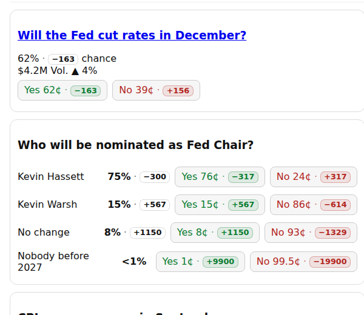
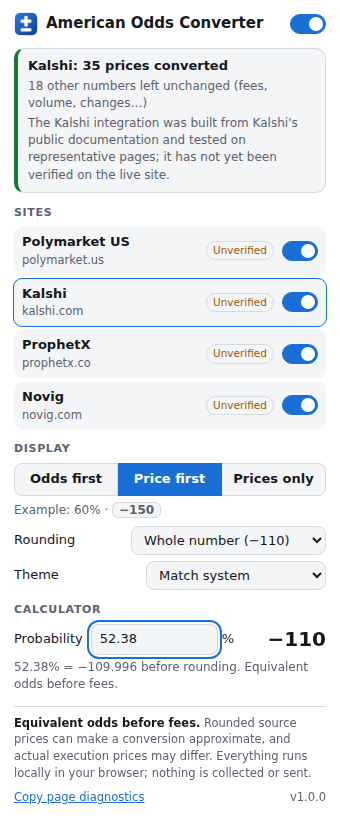
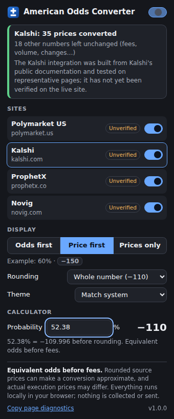

# American Odds Converter

A Microsoft Edge and Google Chrome extension (Manifest V3) that shows **equivalent American odds** next to prices on **Polymarket US, Kalshi, ProphetX and Novig**, so you can read and compare them the sportsbook way:

```
Yes 62¢ · −163      60% · −150      PHI −1.5 52¢ · −108      Last 62¢ · −163 last
```

Since the CFTC's August 2026 guidance, these exchanges show contract prices as cents or percentages instead of American odds. This extension converts them locally in your browser. It doesn't collect or send any data.



_Representative test page. See the [compatibility report](docs/COMPATIBILITY.md) for the status on the live sites._

> **Status: all four integrations are unverified on the live websites.** They were built from each platform's public documentation and tested extensively on representative pages, but the sites themselves couldn't be reached from the build environment. The popup marks each one **Unverified**. See [docs/COMPATIBILITY.md](docs/COMPATIBILITY.md) for the evidence, open questions and the few minutes of checking needed to complete each one.

---

## Download

| What | Where |
|---|---|
| Ready-to-load ZIP | [`release/american-odds-converter-v1.0.0.zip`](release/american-odds-converter-v1.0.0.zip) |
| Unpacked folder (`manifest.json` at its root) | [`release/american-odds-converter/`](release/american-odds-converter/) |
| Source code | [`src/`](src/) (TypeScript), build scripts in [`scripts/`](scripts/) |

On GitHub, open the ZIP file and click **Download raw file**. Alternatively, use **Code → Download ZIP** for the whole repository and use the `release/american-odds-converter` folder inside it.

## Install

### 1. Unzip it into a permanent folder

- **Windows:** right-click the ZIP → **Extract All…** → choose a folder you'll keep, for example `Documents\American Odds Converter`.
- **macOS:** double-click the ZIP, then move the resulting folder somewhere permanent, for example `Documents`.

The folder you choose must contain `manifest.json` directly, not inside another sub-folder. Don't delete or move this folder later: the browser loads the extension from it.

### 2a. Google Chrome

1. Go to `chrome://extensions` in the address bar.
2. Turn on **Developer mode** (switch in the top-right corner).
3. Click **Load unpacked** (top-left).
4. Select the folder from step 1, the one containing `manifest.json`, and confirm.
5. Pin it: click the puzzle-piece **Extensions** icon in the toolbar, then the pin next to **American Odds Converter**.

### 2b. Microsoft Edge

1. Go to `edge://extensions` in the address bar.
2. Turn on **Developer mode** (switch in the left sidebar; on narrow windows open the ☰ menu first).
3. Click **Load unpacked**.
4. Select the folder from step 1, the one containing `manifest.json`, and confirm.
5. Pin it: click the puzzle-piece **Extensions** icon in the toolbar, then the eye icon (**Show in toolbar**) next to **American Odds Converter**.

### 3. Use it

Open or **reload** a tab on polymarket.us, kalshi.com, prophetx.co or novig.com. Tabs that were already open before you installed need one reload. Click the toolbar icon to see the status for the current tab.

The browser may occasionally remind you that a developer-mode extension is installed. That's normal for extensions loaded this way; keep it enabled.

## Update to a new version

1. Download and unzip the new version **into the same folder**, replacing the old files. Delete the old files first so nothing stale remains.
2. Open `chrome://extensions` or `edge://extensions` and click the **reload** button (↻) on the American Odds Converter card.
3. Reload any open tabs on the supported sites.

Your preferences are kept as long as you reload from the same folder. If you load from a different folder instead, the browser treats it as a new extension, so remove the old one and set your preferences again.

## Remove

1. Open `chrome://extensions` or `edge://extensions`.
2. On the **American Odds Converter** card, click **Remove** and confirm.
3. Delete the folder you unzipped. Labels disappear from open pages right away, or after a reload.

---

## Using it

### On the page

Each recognised price gets a small label next to it, inside the same button or cell, so it stays attached to the right outcome:

| What you see | What it means |
|---|---|
| `Yes 62¢ · −163` | A price shown on an outcome button, converted to equivalent American odds |
| `62% · −163` beside "chance" (dotted outline) | The site's **estimated chance**, not a price you can trade at |
| `Last 62¢ · −163 last` (dashed outline) | The **last traded price**, not an executable offer |
| Bid / Ask columns, or a selected Buy/Sell tab | Labelled as a **sell** (bid) or **buy** (ask) quote in the tooltip |
| `Yes 100¢ · n/a` | 0% and 100% have no finite American odds; the tooltip explains why |

Hover over a label for the details: "**Equivalent odds before fees**", what the source price was, and, if that price might itself be rounded, the range of odds it could stand for. For example, "62¢ could be 61.5–62.5¢ → −160 to −167". Actual execution prices may differ.

**What it leaves alone:**
- account balances, P/L, volume, price changes (▲ 4%), fees, commission, payouts and average prices
- scores and records, spread lines (−3.5) and totals (O 47.5); only their *prices* are converted
- `<1%` and `>99%`, payout multipliers (1.6x), bare numbers (0.62)
- prices already shown in American odds, and percentages that are part of a name ("Above 3.0%")
- order-entry fields and buttons such as `25%` / `Max`

Yes and No prices are converted independently; a missing side is never made up by subtracting from 100%. Account, portfolio, wallet and help pages are skipped entirely.

### The popup

 

- **Master switch** (top right) turns all conversions on or off, instantly.
- **Status** shows whether the current tab is supported and how many prices were converted or left unchanged, or tells you to reload.
- **Sites:** a switch for each platform.
- **Display:** *Odds first* (`−150 · 60%`), *Price first* (`60% · −150`, the default) or *Prices only* (no labels).
- **Rounding:** whole number (default), one decimal, or nearest 5.
- **Theme:** match system, light or dark.
- **Calculator:** type a probability (e.g. `52.38`) to get the American odds.
- **Copy page diagnostics:** copies a report of how each price-like number on the page was handled, to help fix an integration. It contains the page's visible text near prices, so review it before sharing.

Preferences are saved with `chrome.storage.local` and persist after the browser restarts.

## How the conversion works

The displayed percentage is turned into an exact probability *p* (0–1). The digits are kept as exact integers, so `52.38%` is exactly 5238/10000, and the result is rounded only for display.

- *p* below 50%: **+100 × (1 − p) / p**
- *p* above 50%: **−100 × p / (1 − p)**
- exactly 50%: **+100**
- 0% or 100%: no finite odds, shown as **n/a** with an explanation

| Probability | 10% | 20% | 25% | 40% | 50% | 52.38% | 60% | 75% | 80% | 90% |
|---|---|---|---|---|---|---|---|---|---|---|
| American odds | +900 | +400 | +300 | +150 | +100 | −110 | −150 | −300 | −400 | −900 |

A cents price (`62¢`) or dollar price (`$0.62`) is read as 62% only because these four exchanges' contracts pay **$1** to the winning side (per each platform's documentation), *and* only when the page context shows it's the price of a specific outcome. Arbitrary dollar amounts and bare numbers are never treated as probabilities.

## Privacy and permissions

- **Site access** is limited to `polymarket.us`, `kalshi.com`, `www.prophetx.co` / `prophetx.co`, `novig.com` and `app.novig.us`. The browser shows this as "Read and change your data on these sites". The extension only reads visible price text and adds labels.
- **`storage`** saves your preferences on this device.
- **`activeTab`** lets the popup see the address of the tab you're looking at, only when you click the icon, so it can say whether the page is supported. No access to other tabs or your history.
- It sends **no network requests** and collects no credentials, account information or browsing history. It has no analytics, and no background script.

## Compatibility

| Platform | Hosts | Formats | Status |
|---|---|---|---|
| Polymarket US | polymarket.us | %, ¢ (incl. 0.5¢ ticks), $0.xx | Unverified on live site, fixture-tested |
| Kalshi (incl. Kalshi Pro) | kalshi.com | %, ¢ | Unverified on live site, fixture-tested |
| ProphetX | www.prophetx.co, prophetx.co | %, $0.xx | Unverified on live site, fixture-tested; trading-app host not confirmed |
| Novig | novig.com, app.novig.us | % | Unverified on live site, fixture-tested |

International Polymarket (`polymarket.com`) is a separate platform and is deliberately not supported. Full details, sources and limitations are in [docs/COMPATIBILITY.md](docs/COMPATIBILITY.md). What was tested and how is in [docs/TESTING.md](docs/TESTING.md).

Requires Chrome or Edge 111 or newer.

---

## Development

Requires Node.js 20+.

```bash
npm install
npm run build        # bundles TypeScript into dist/ (an unpacked extension)
npm test             # unit + jsdom fixture tests
npm run test:e2e     # builds, then runs the extension in Chromium (npx playwright install chromium first)
npm run package      # builds and writes release/american-odds-converter/ + release/american-odds-converter-v<version>.zip
npm run verify       # typecheck + all tests + package
```

```
src/
  manifest.json            Manifest V3 (permissions: storage, activeTab)
  core/odds.ts             shared conversion module (exact arithmetic, rounding, 0%/100%)
  core/parse.ts            price-token parsing, existing-American-odds detection
  core/platforms.ts        supported hosts (single source of truth, checked against the manifest)
  core/settings.ts         preferences (chrome.storage.local)
  content/detect.ts        shared detection rules (captions, buttons, tables, rows, traps)
  content/engine.ts        live updates: MutationObserver batching, SPA navigation, no duplicates/loops
  content/label.ts         the label (shadow-DOM custom element) and its tooltip
  content/adapters/*.ts    one integration per platform (hosts, formats, excluded pages, rules)
  content/entries/*.ts     one content script per platform
  popup/                   popup UI (HTML/CSS/TS); model.ts holds the testable logic
test/
  unit/  dom/  e2e/        Vitest unit + jsdom tests, Playwright browser tests
  fixtures/*.html          representative pages with expected results and traps
```

The shipped JavaScript is bundled but not minified, so it can be reviewed.

## License

MIT. See [LICENSE](LICENSE).
